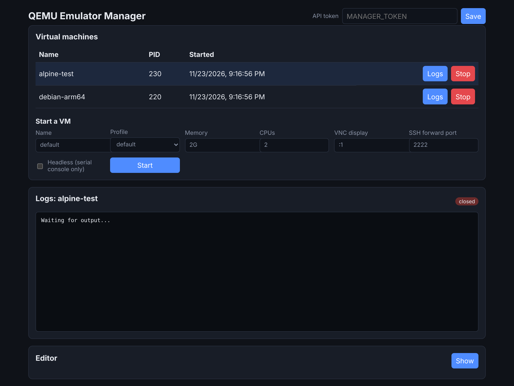

<div align="center">

# 🖥️ QEMU Emulator Manager

**Run, watch and control ARM64 virtual machines from your browser.**

[](https://github.com/MarbleLabs1/IOS-emulator/actions/workflows/ci.yml)
[](linux-emulator-server)
[](src)
[](https://www.qemu.org)
[](linux-emulator-server/LICENSE)

[Quick start](#quick-start) · [Docker](#docker) · [Security](#security) · [API](#api) · [Configuration](#configuration)

</div>

---



## ✨ Features

- ▶️ **Start / stop VMs** from a dashboard or the HTTP API
- 📜 **Live console logs** streamed over WebSocket
- 🖧 **VNC and SSH** access, bound to `127.0.0.1` by default
- 🔐 **Token-protected API**, loopback-only unless you opt in
- 🐳 **Docker, systemd and Kubernetes** files included
- 🧪 **Tested end to end**: CI runs the Go and UI checks and boots a real ARM64 VM through the API

## 🧭 How it works

```
 Browser ──HTTP/WS──▶  Go manager (:8080)  ──spawns──▶  enhanced-run.sh ──▶ qemu-system-aarch64
 (React UI)            auth · API · logs                 one script per VM     ARM64 Linux guest
                                                                               │
                                              VNC 127.0.0.1:590N ◀─────────────┤
                                              SSH 127.0.0.1:2222 ◀─────────────┘
```

> ⚠️ **Not an iOS emulator.** iOS needs Apple's proprietary, signed boot chain and hardware, which QEMU cannot provide. This project boots ARM64 Linux (and any other UEFI-bootable ARM64 OS).

## Quick start

Requirements: Go 1.21+, Node 18+, and QEMU with UEFI firmware (`make vm-setup` installs both on Debian/Ubuntu, Fedora and Arch).

```bash
cd linux-emulator-server && make vm-setup   # QEMU + firmware (needs sudo)
cd .. && ./start.sh                         # builds the UI and manager, then runs it
```

Open <http://127.0.0.1:8080>. The manager listens on loopback only unless you set `MANAGER_ADDR` and `MANAGER_TOKEN`.

To install an OS, create a VM from the dashboard, or from a shell:

```bash
linux-emulator-server/src/scripts/enhanced-run.sh --name demo --iso ~/debian-arm64.iso --memory 4G --cpus 4
```

Connect with a VNC client to `127.0.0.1:5900` (display `:0`) and SSH with `ssh -p 2222 user@127.0.0.1` once the guest runs an SSH server.

> **Speed:** on an x86 host the guest is emulated in software (TCG) and is slow. KVM acceleration is used automatically on ARM64 Linux hosts with `/dev/kvm`.

## Run it as a service

```bash
sudo ./install.sh
```

Installs to `/opt/qemu-ios-emulator`, creates a hardened systemd unit, and writes a random API token to `/etc/qemu-ios-emulator/manager.env`.

## Docker

```bash
echo "MANAGER_TOKEN=$(openssl rand -hex 32)" > .env
docker compose -f docker-compose.qemu.yml up -d
```

Ports are published on `127.0.0.1` only. Use an SSH tunnel or a TLS reverse proxy for remote access.

## Security

- `/api/*` requires `MANAGER_TOKEN` (Bearer header, or `?token=` for the log WebSocket). The manager refuses to listen on a non-loopback address without it.
- VNC and SSH forwards bind to `127.0.0.1` by default. VNC has no password, so never expose it directly.
- The file editor and compiler (`IDE_ENABLED=true`) can read, write and compile files. It is off by default, requires a token, and is confined to `IDE_ROOT`.
- Put TLS in front of the manager before using it across a network.

## API

| Method | Path | Purpose |
| --- | --- | --- |
| GET | `/healthz` | Health check (no auth) |
| POST | `/api/v1/vm/start` | Body: `name`, optional `profile` (`default`\|`max`), `memory`, `cpus`, `vnc`, `ssh_port`, `headless` |
| POST | `/api/v1/vm/stop` | Body: `{"name": "..."}` |
| GET | `/api/v1/vm/status?name=` | One running VM |
| GET | `/api/v1/vm/list` | All running VMs |
| WS | `/api/v1/ws/logs?name=` | Live console log |
| GET/POST | `/api/v1/ide/{list,read,write,build}` | Only when `IDE_ENABLED=true` |

## Configuration

| Variable | Default | Meaning |
| --- | --- | --- |
| `MANAGER_ADDR` | `127.0.0.1:8080` | Listen address (or use `MANAGER_PORT`) |
| `MANAGER_TOKEN` | none | API secret; required for non-loopback addresses |
| `MANAGER_STATIC_DIR` | `dist` if present | Built web UI |
| `EMULATOR_RUNNER` | `src/scripts/enhanced-run.sh` | Script that launches one VM |
| `EMULATOR_LOG_DIR` | `/var/log/qemu-ios-emulator` | VM logs (falls back to the temp dir) |
| `VM_DIR` | `/var/lib/qemu-ios-emulator/vms` | VM disks (falls back to `~/.local/share`) |
| `FIRMWARE` | auto-detected | Path to `QEMU_EFI.fd` |
| `IDE_ENABLED` / `IDE_ROOT` | off / `./workspace` | Remote editor |

## Development

```bash
npm run dev          # UI on :5173, proxies /api to the manager on :8080
npm run lint && npm run type-check
cd linux-emulator-server && make test vet
```

Layout: `src/` React UI, `linux-emulator-server/cmd/manager` API entrypoint, `internal/manager` VM lifecycle and log streaming, `internal/ide` confined file editor, `src/scripts/enhanced-run.sh` QEMU launcher, `docker/` and `infra/k8s/` deployment files.
